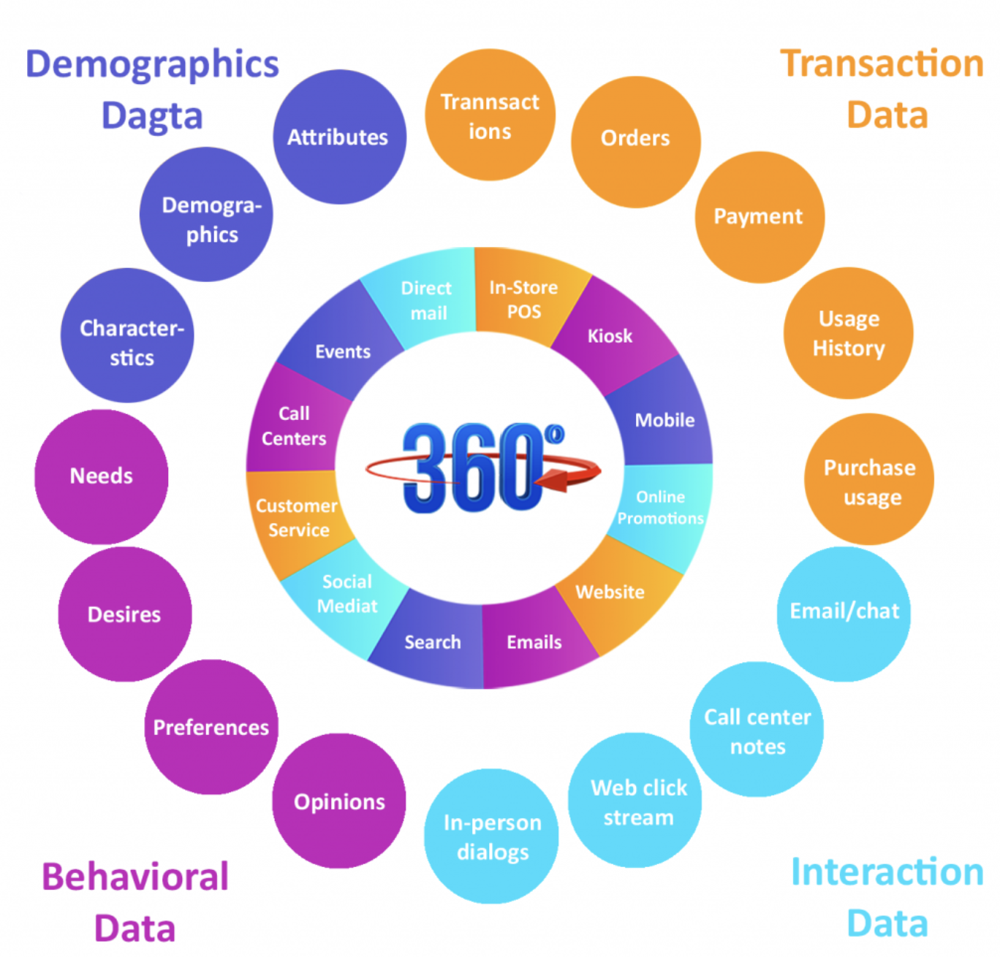
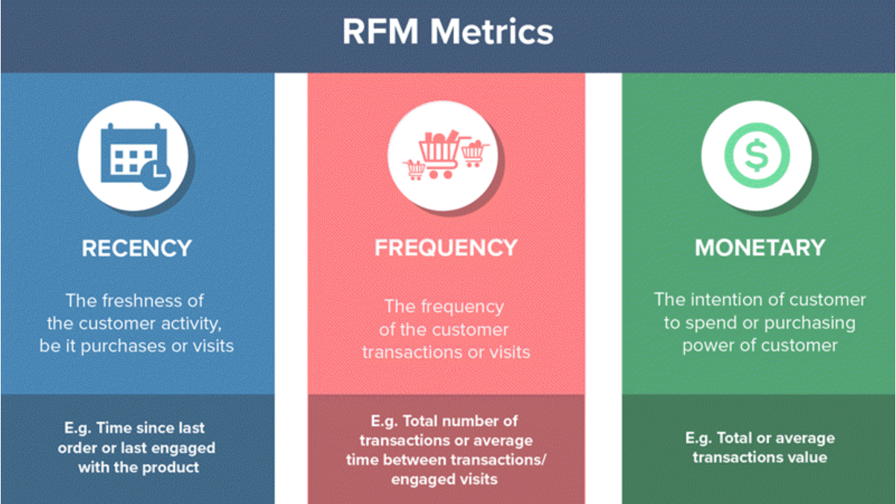
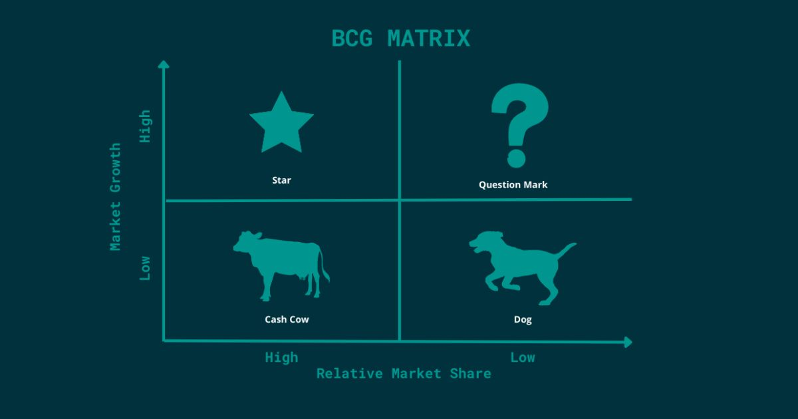
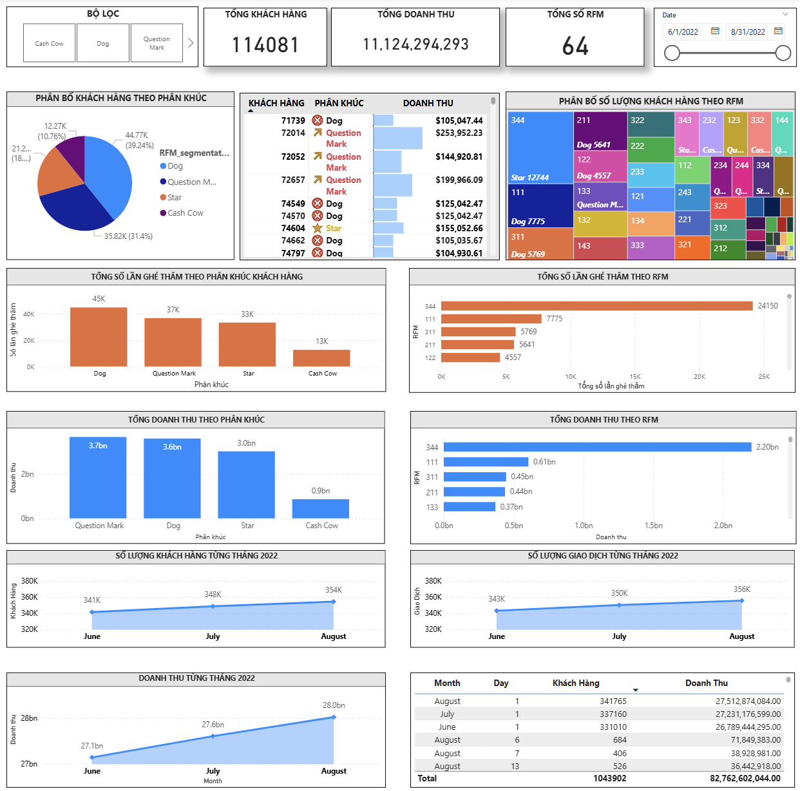
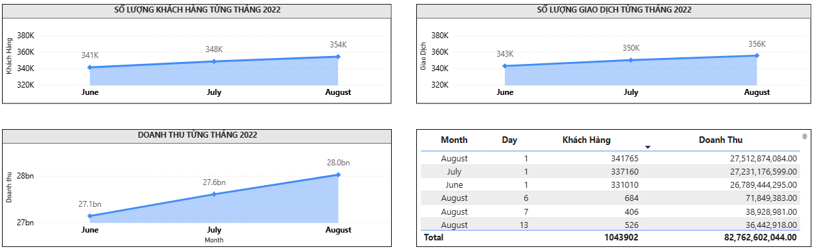
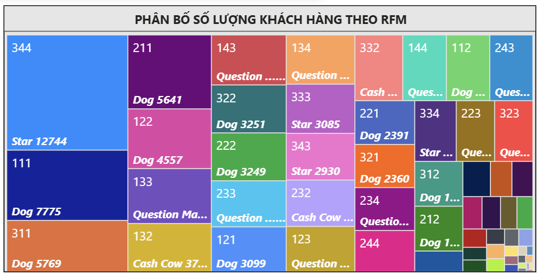
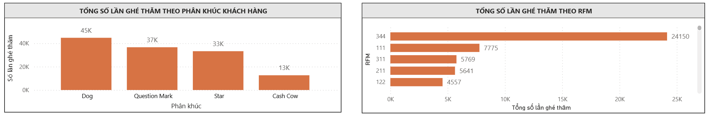
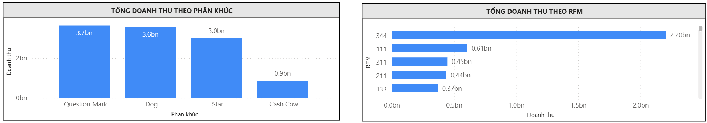

# 📊 CUSTOMER 360: DATA ANALYSIS REPORT
### Phân tích RFM & Phân khúc Khách hàng theo Ma trận BCG

[](https://www.mysql.com/)
[](https://powerbi.microsoft.com/)
[]()
[]()

> **Mục đích dự án:** Cung cấp cái nhìn 360° về hành vi và giá trị khách hàng để phân khúc chính xác, tối ưu hóa chiến dịch marketing và nâng cao khả năng giữ chân, tăng doanh thu.

---

## 📑 Mục lục
1. [Cấu trúc thư mục Repository](#1-cấu-trúc-thư-mục-repository)
2. [Tổng quan Customer 360](#2-tổng-quan-customer-360)
3. [Phân tích RFM](#3-phân-tích-rfm)
4. [Ma trận BCG (BCG Matrix)](#4-ma-trận-bcg-bcg-matrix)
5. [Trường dữ liệu đầu vào](#5-trường-dữ-liệu-đầu-vào)
6. [Phân loại khách hàng trên SQL](#6-phân-loại-khách-hàng-trên-sql)
7. [Phân tích chuyên sâu & Trực quan hóa Dashboard](#7-phân-tích-chuyên-sâu--trực-quan-hóa-dashboard)
8. [Các đề xuất nâng cao hiệu quả kinh doanh](#8-các-đề-xuất-nâng-cao-hiệu-quả-kinh-doanh)

---

## 1. Cấu trúc thư mục Repository

```text
Customer_360_RFM-BCG/
├── README.md                            # Báo cáo tổng quan dự án
├── data/
│   ├── sample/                          # Dữ liệu mẫu (~1.000 dòng) phục vụ kiểm thử
│   └── README.md                        # Data Dictionary & mô tả chi tiết trường dữ liệu
├── sql/
│   └── customer_360.sql                 # Truy vấn SQL tính RFM, IQR và phân nhóm BCG
├── power_bi/
│   └── customer_360_dashboard.pbix      # File Dashboard tương tác Power BI
├── reports/
│   └── customer_360_business_report.pdf # Bản báo cáo phân tích đầy đủ (PDF)
└── docs/images/                         # Hình ảnh minh họa & biểu đồ Dashboard
```

---

## 2. Tổng quan Customer 360

**Customer 360** là cách tiếp cận toàn diện nhằm xây dựng cái nhìn thống nhất về khách hàng trên toàn tổ chức — tích hợp từ thông tin định danh, lịch sử giao dịch, tương tác đa kênh đến vị trí của khách hàng trong vòng đời quan hệ với doanh nghiệp (tiềm năng, mới, trung thành).

* **Vai trò cốt lõi:** Hiểu sâu khách hàng $\rightarrow$ Cá nhân hóa ưu đãi đúng đối tượng $\rightarrow$ Tăng doanh thu & lòng trung thành $\rightarrow$ Tối ưu quyết định marketing và dự đoán sớm rủi ro rời bỏ.
* **4 nhóm dữ liệu trong Customer 360:**
  * **Demographics Data:** Thông tin cơ bản (tuổi, giới tính, nơi ở, chi nhánh, thuộc tính nhận dạng).
  * **Transaction Data:** Lịch sử mua sắm, đặt hàng, thanh toán và giá trị sử dụng sản phẩm/dịch vụ.
  * **Interaction Data:** Dữ liệu phản ánh quá trình tương tác của khách hàng với doanh nghiệp (lượt ghé thăm, kênh tiếp xúc).
  * **Behavioral Data:** Nhu cầu, sở thích, thói quen và hành vi phát sinh trong quá trình sử dụng.

<p align="center">
  
</p>

---

## 3. Phân tích RFM

**RFM (Recency - Frequency - Monetary)** là kỹ thuật marketing đánh giá và phân nhóm khách hàng dựa trên 3 yếu tố hành vi mua sắm:
* **Recency (Gần đây):** Khách hàng có mua hàng gần đây hay không? (Thời gian từ lần giao dịch cuối cùng).
* **Frequency (Tần suất):** Khách hàng mua hàng bao nhiêu lần? (Mức độ thường xuyên giao dịch).
* **Monetary (Giá trị):** Khách hàng đã chi tiêu bao nhiêu tiền? (Tổng doanh số mang lại).

Dựa vào 3 yếu tố này, mỗi khách hàng được chấm điểm và ghép thành tổ hợp điểm `R-F-M` (ví dụ: `R=1, F=3, M=2` $\rightarrow$ `RFM = 132`), giúp doanh nghiệp nắm rõ hành vi mua sắm và cá nhân hóa chiến lược chăm sóc.

<p align="center">
  
</p>

---

## 4. Ma trận BCG (BCG Matrix)

**Ma trận BCG** (do Boston Consulting Group phát triển) được ứng dụng để phân loại các tệp khách hàng thành 4 nhóm chiến lược:
* ⭐ **Stars (Ngôi sao):** Tệp khách hàng có mức độ tương tác và giá trị chi tiêu cao nhất, cần ưu tiên đầu tư lớn để duy trì sự gắn bó.
* 🐮 **Cash Cows (Bò sữa):** Tệp khách hàng mua sắm thường xuyên, tạo ra dòng tiền ổn định nhưng giá trị mỗi đơn hàng chưa cao.
* ❓ **Question Marks (Dấu hỏi):** Tệp khách hàng có tiềm năng chi tiêu lớn nhưng tần suất thấp hoặc có nguy cơ rời bỏ — cần chiến lược chăm sóc đúng đắn để chuyển đổi thành *Star*.
* 🐕 **Dogs (Con chó):** Tệp khách hàng tần suất mua thấp và giá trị chi tiêu nhỏ — không tạo ra lợi nhuận đủ lớn để đầu tư chi phí chăm sóc cao.

<p align="center">
  
</p>

---

## 5. Trường dữ liệu đầu vào

Dự án xử lý tập dữ liệu thực tế với hơn **1.000.000 bản ghi** gồm 2 bảng chính:

1. **Bảng `Customer_Registered`:** Lưu trữ thông tin hợp đồng của khách hàng đã đăng ký (`ID`, `Contract`, `LocationID`, `BranchCode`, `Status`, `created_date`, `stopdate`). Đây là bảng gốc xác định thời điểm bắt đầu/kết thúc dịch vụ, chi nhánh địa lý và trạng thái hoạt động.
2. **Bảng `Customer_Transaction`:** Lưu trữ chi tiết từng giao dịch của khách hàng (`Transaction_ID`, `CustomerID`, `Purchase_Date`, `GMV`), ghi nhận ngày phát sinh và tổng giá trị giao dịch.

**Mô hình quan hệ (Data Relationship):**  
`Customer_Registered.ID` (1) ───< `Customer_Transaction.CustomerID` (N)

---

## 6. Phân loại khách hàng trên SQL

Quá trình xử lý và phân khúc dữ liệu trên **MySQL** ([`sql/customer_360.sql`](sql/customer_360.sql)) gồm 3 bước chính:

### Bước 1: Tính toán và chuẩn hóa chỉ số RFM theo năm
Để loại bỏ sự thiên lệch (bias) do thời gian hợp đồng dài/ngắn khác nhau giữa các khách hàng, các chỉ số được chuẩn hóa theo **độ tuổi hợp đồng (`Contract_age`)** tính đến ngày mốc `2022-09-01`:
* **`Contract_age`:** Khoảng cách từ `created_date` đến `2022-09-01` chia cho `365.0`.
* **`Recency`:** Khoảng cách ngày từ ngày mua gần nhất (`MAX(Purchase_Date)`) đến `2022-09-01`.
* **`Frequency`:** Tổng số lần giao dịch chia cho độ tuổi hợp đồng (tần suất mua/năm).
* **`Monetary`:** Tổng giá trị `GMV` chia cho độ tuổi hợp đồng (chi tiêu/năm).

### Bước 2: Áp dụng IQR (Interquartile Range) để xếp hạng và chấm điểm 1 - 4
**IQR (Khoảng tứ phân vị)** chia tập dữ liệu thành 4 phần bằng nhau (mỗi phần 25%) qua 3 mốc **Q1**, **Q2 (Median)** và **Q3**:

<p align="center">
  
</p>

* Sử dụng hàm cửa sổ `ROW_NUMBER()` xếp thứ tự từng chỉ số để trích xuất các ngưỡng Q1 (25%), Q2 (50%), Q3 (75%).
* Dùng `CASE WHEN` chia thành 4 nhóm gán điểm từ **1 đến 4**:
  * **Recency:** Mua càng gần đây điểm càng cao ($\text{Min} \le R < Q_1 \rightarrow 4$; $Q_1 \le R < Q_2 \rightarrow 3$; $Q_2 \le R < Q_3 \rightarrow 2$; còn lại $\rightarrow 1$).
  * **Frequency & Monetary:** Tần suất và chi tiêu càng lớn điểm càng cao ($\text{Min} \le X < Q_1 \rightarrow 1$; $Q_1 \le X < Q_2 \rightarrow 2$; $Q_2 \le X < Q_3 \rightarrow 3$; còn lại $\rightarrow 4$).
* Ghép 3 điểm số bằng `CONCAT(R_Scale, F_Scale, M_Scale)` tạo thành **64 mã định danh RFM** (ví dụ: `344`, `421`).

### Bước 3: Phân nhóm RFM theo Ma trận BCG & Tổng hợp (`GROUP_CONCAT`)

| Nhóm BCG | Kiểu khách hàng | Điều kiện điểm (R - F - M) | Danh sách mã RFM tương ứng | Số lượng | Đặc điểm nhận diện |
|---|---|---|---|---|---|
| ⭐ **Star** | **VIP** | `R:[3,4]`, `F:[3,4]`, `M:[3,4]` | `444, 443, 434, 433, 344, 343, 334, 333` | **21,224** | Giao dịch gần đây, tần suất mua cao và chi tiêu lớn — tệp VIP mang lại giá trị cao nhất. |
| ❓ **Question Mark** | **Tiềm năng** | `F:[1,2], M:[3,4]` hoặc `R:[1,2], F:[3,4], M:[3,4]` | `424, 423, 414, 413, 324, 323, 314, 313, 244, 243, 234, 233, 144, 143, 134, 133...` | **35,817** | Khách mới chi tiêu cao nhưng mua ít, hoặc **cựu VIP** lâu chưa quay lại — cần nuôi dưỡng hoặc tái kích hoạt khẩn cấp. |
| 🐮 **Cash Cow** | **Trung thành** | `R:[1..4]`, `F:[3,4]`, `M:[1,2]` | `442, 441, 432, 431, 342, 341, 332, 331, 242, 241, 232, 231, 142, 141, 132, 131` | **12,274** | Mua hàng đều đặn nhưng chi tiêu mỗi đơn thấp — tạo dòng tiền ổn định, cần duy trì và kích cầu giỏ hàng. |
| 🐕 **Dog** | **Vãng lai** | `R:[1..4]`, `F:[1,2]`, `M:[1,2]` | `422, 421, 411, 322, 321, 312, 311, 222, 221, 212, 211, 122, 121, 112, 111` | **44,766** | Mua ít, chi tiêu thấp hoặc đã rời bỏ — chỉ nên tiếp cận qua các kênh tự động chi phí thấp. |

---

## 7. Phân tích chuyên sâu & Trực quan hóa Dashboard

### 7.1. Tổng quan Dashboard & Quy mô hệ thống
* **Tổng khách hàng:** `114,081` khách hàng | **Tổng doanh thu:** `11,124,294,293 VNĐ` (~11.1 tỷ VNĐ) | **Tổng số RFM:** `64` phân khúc.
* Doanh nghiệp có tệp khách hàng lớn và doanh thu cao, nhưng cần tập trung khai thác nhóm giá trị cao và tinh gọn 64 phân khúc RFM vào 4 nhóm BCG để triển khai Marketing hiệu quả.



---

### 7.2. Xu hướng doanh thu, lượng khách và giao dịch theo tháng



* **Số lượng khách hàng tăng đều đặn:** Từ **341K** (tháng 6) $\rightarrow$ **348K** (tháng 7) $\rightarrow$ **354K** (tháng 8), cho thấy doanh nghiệp giữ được sức hút mở rộng ổn định.
* **Lượng giao dịch tăng cùng nhịp với lượng khách:** Từ **343K** (tháng 6) $\rightarrow$ **356K** (tháng 8). Tỷ lệ giao dịch duy trì quanh mức **~1 giao dịch/khách/tháng** — khách hàng chỉ mua 1 lần mỗi tháng, gần như không có hành vi mua lặp lại.
* **Doanh thu tăng nhẹ từ 27.1bn $\rightarrow$ 28.0bn:**
  * **👉 Finding cốt lõi:** Doanh số tăng hoàn toàn dựa vào việc **mở rộng quy mô khách hàng mới**, không xuất phát từ việc khách hàng mua nhiều hơn hay chi tiêu lớn hơn theo từng đơn. Nếu lượng khách mới giảm, doanh thu sẽ giảm theo $\rightarrow$ Cần các chiến dịch gia tăng giá trị giỏ hàng và bán chéo.

---

### 7.3. Phân bố theo phân khúc khách hàng & Tổ hợp RFM



* **Cơ cấu 4 nhóm BCG:**
  * **Dog chiếm tỷ trọng áp đảo (39.24% - 44.77K khách):** Phần lớn khách hàng là vãng lai hoặc đã rời bỏ, bị phân mảnh ở các mã giá trị thấp (`111`, `311`, `211`, `122`) $\rightarrow$ Thu hút khách dùng thử tốt nhưng tỷ lệ chuyển đổi mua lại rất thấp.
  * **Question Mark chiếm 31.40% (35.82K khách):** Phân bổ ở nhiều nhóm vừa (`133`, `143`, `233`...), là tệp tiềm năng lớn nhất cần chuyển đổi thành Star.
  * **Star (18.59% - 21.22K khách) & Cash Cow (10.76% - 12.27K khách):** Tỷ trọng nhóm mang lại doanh thu ổn định còn thấp; không thể chỉ dựa vào 18.6% Star để gánh doanh thu dài hạn.
* **Điểm nhấn tổ hợp RFM:**
  * **Tổ hợp `344` (Star) dẫn đầu quy mô với 12,744 khách**, vượt trội hoàn toàn so với các nhóm còn lại.
  * **Nhiều cựu VIP có thể tái kích hoạt (`133`, `134`, `144`, `244`):** Doanh nghiệp đang để mất tệp khách từng trung thành và chi tiêu lớn.

---

### 7.4. Phân tích hành vi ghé thăm (Visit Behavior)



* **Dog dẫn đầu lượt ghé thăm (45K lượt)** dù có giá trị thấp nhất $\rightarrow$ Hành vi đặc trưng **"Quan tâm nhưng không mua"**.
* **Question Mark (37K lượt) và Star (33K lượt) có lượng ghé thăm cao:** Dù chỉ có ~21.2K khách hàng nhưng Star tạo ra tới 33K lượt ghé thăm $\rightarrow$ **Star có mức độ tương tác và quay lại cao nhất hệ thống**.
* **Cash Cow thấp nhất (13K lượt ~ 12.27K khách):** Cần duy trì chăm sóc nếu không sẽ có nguy cơ rơi xuống nhóm Dog.
* **Chi tiết theo mã RFM:**
  * **Mã `344` hoạt động mạnh nhất** với **24,150 lượt ghé thăm** $\rightarrow$ Cần chương trình độc quyền để giữ chân lâu dài.
  * **Các VIP cũ (`133`, `143`) vẫn còn sự quan tâm lớn:** Dù lâu chưa mua gần đây ($R=1$), nhóm này vẫn nằm trong **Top 10 lượt ghé thăm** $\rightarrow$ Cơ hội tái kích hoạt thành công rất cao.
  * **Các nhóm `111`, `211`, `122`** có lượng ghé thăm đáng kể nhưng chưa chuyển đổi thành đơn hàng giá trị.

---

### 7.5. Phân tích cơ cấu doanh thu (Revenue Analysis)



* **Doanh thu theo phân khúc BCG:**
  * **Question Mark đóng góp lớn nhất với 3.7bn VNĐ**, vượt cả nhóm VIP (Star).
  * **Dog đạt 3.6bn VNĐ** (gần tương đương Question Mark) nhờ **"Hiệu ứng số đông"** (44.7K khách; riêng các mã `111`, `311`, `211` gom hơn 1.4bn) dù giá trị đơn hàng thấp $\rightarrow$ Cần tối ưu chi phí phục vụ để giữ biên lợi nhuận.
  * **Star đạt 3.0bn VNĐ với hiệu suất sinh lời vượt trội:** Chỉ 21.22K khách tạo ra 3.0bn (**~141K VNĐ/người**), cao gấp 1.75 lần nhóm Dog.
  * **Cash Cow thấp nhất với 0.9bn VNĐ** do giá trị giỏ hàng còn khiêm tốn.
* **Mức độ tập trung doanh thu vào mã `344`:**
  * **Mã `344` thống trị tuyệt đối với 2.20bn VNĐ**, gấp gần **4 lần** nhóm đứng thứ hai (mã `111` với 0.61bn).
  * **Gần 20% tổng doanh thu toàn doanh nghiệp (2.2bn / 11.1bn)** đến từ duy nhất mã `344` $\rightarrow$ Doanh nghiệp phụ thuộc rất lớn vào nhóm này, cần ưu tiên bảo vệ hàng đầu.

---

## 8. Các đề xuất nâng cao hiệu quả kinh doanh

| Phân khúc | Chiến lược đề xuất trọng tâm |
|---|---|
| ⭐ **Giữ chân Star**<br>*(Trọng tâm mã `344`)* | • Xây dựng chương trình khách hàng cao cấp phân tầng với ưu đãi độc quyền và chăm sóc cá nhân hóa.<br>• **Ưu tiên mở bán sản phẩm cao cấp cho nhóm `344`** nhằm bảo vệ 20% doanh thu nòng cốt.<br>• Thường xuyên thu thập phản hồi, tặng quà/ưu đãi theo hành vi để tăng lòng trung thành và khuyến khích giới thiệu bạn bè (Referral). |
| ❓ **Win-back & Chuyển đổi Question Mark** | • **Tự động hóa tiếp thị (SMS/Email)** gửi voucher giới hạn thời gian để kéo nhóm **cựu VIP (`133`, `134`, `144`, `244`)** quay lại.<br>• Cung cấp trải nghiệm mua sắm mượt mà ngay từ đầu và tặng ưu đãi cho lần mua tiếp theo nhằm chuyển đổi thành khách hàng VIP (*Star*) hoặc trung thành (*Cash Cow*). |
| 🐮 **Nâng giá trị đơn cho Cash Cow** | • Áp dụng chính sách **bán hàng theo combo (Bundles)**, đề xuất sản phẩm **bán chéo (Cross-sell)**.<br>• Đặt ngưỡng giá trị đơn tối thiểu để nhận ưu đãi và tích lũy điểm thưởng theo giá trị đơn nhằm kích thích chi tiêu nhiều hơn trong mỗi lần mua. |
| 🐕 **Phân hóa & Chuyển đổi nhóm Dog** | • **Tận dụng 45K lượt ghé thăm tự nhiên** qua các kênh 0 đồng (thông báo App/Email).<br>• Thiết lập kịch bản **kích hoạt mua lại lần 2** ngay cho nhóm khách mới (`311`, `211`).<br>• Gom đơn giá rẻ bằng các đợt **Flash Sale ngắn hạn** để thanh lọc tồn kho và tối ưu doanh thu từ tệp vãng lai (`111`). |
